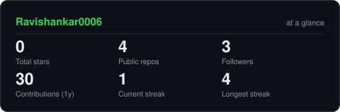
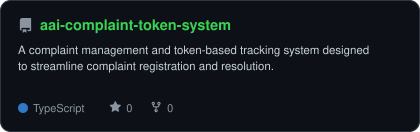
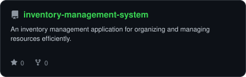
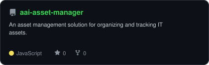

<!-- PORTRAIT - generated by scripts/dotify.py from assets/jacket.png.
     Colour mode, so one file serves both GitHub themes. Regenerate with:
       python scripts/dotify.py assets/jacket.png -o assets/portrait \
         --cols 100 --equalize --detail 0.5 --color -->
<picture>
  <source media="(prefers-color-scheme: dark)" srcset="assets/portrait-dark.svg">
  <source media="(prefers-color-scheme: light)" srcset="assets/portrait-light.svg">
  
</picture>

 

<!-- NAME / TAGLINE - animated typing -->

 

<!-- SOCIALS -->

---

## ~/ whoami

Hi, I'm **Ravi Shankar Bhardwaj**.

I'm pursuing **B.Tech in Information Technology at GJUS&T** and **BS in Data Science at IIT Madras**. I'm interested in AI, Data Science, Generative AI, Cloud Computing and software development.

- Google Cloud Certified with 55+ skill badges
- Exploring GenAI, Vertex AI and Gemini API
- AI & Data Analytics Intern at Airports Authority of India (AAI), IGI Airport
- Building practical projects with modern web technologies
- Interested in solving real-world problems through technology

 

## `~/` toolbox

---

## `~/` skill radar

<table>
<tr>
<td width="50%" align="center" valign="middle">

<!-- Self-rated radar - edit assets/skills.json, the workflow redraws it -->
<picture>
  <source media="(prefers-color-scheme: dark)"  srcset="assets/radar-dark.svg">
  <source media="(prefers-color-scheme: light)" srcset="assets/radar-light.svg">
  
</picture>

</td>
<td width="50%" align="center" valign="middle">

<!-- Live radar built from real language byte counts across your repos -->
<picture>
  <source media="(prefers-color-scheme: dark)"  srcset="assets/radar-langs-dark.svg">
  <source media="(prefers-color-scheme: light)" srcset="assets/radar-langs-light.svg">
  
</picture>

</td>
</tr>
</table>

---

## `~/` contribution calendar

<!-- 3D isometric calendar, regenerated every 6h by .github/workflows/metrics.yml -->

  

<!-- Snake eats the contribution graph - .github/workflows/snake.yml -->
<picture>
  <source media="(prefers-color-scheme: dark)"  srcset="https://raw.githubusercontent.com/Ravishankar0006/Ravishankar0006/output/snake-dark.svg">
  <source media="(prefers-color-scheme: light)" srcset="https://raw.githubusercontent.com/Ravishankar0006/Ravishankar0006/output/snake.svg">
  
</picture>

---

## `~/` the numbers

<!-- Generated by scripts/cards.py into this repo. Deliberately NOT
     github-readme-stats / streak-stats / github-profile-trophy: those are
     shared public instances that go down and take the whole section with them. -->
<picture>
  <source media="(prefers-color-scheme: dark)"  srcset="assets/card-stats-dark.svg">
  <source media="(prefers-color-scheme: light)" srcset="assets/card-stats-light.svg">
  
</picture>

 

  

---

## `~/` selected projects

A selection of projects I've built and contributed to.

 

<a href="https://github.com/Ravishankar0006/aai-complaint-token-system">
  <picture>
    <source media="(prefers-color-scheme: dark)" srcset="assets/card-aai-complaint-token-system-dark.svg">
    <source media="(prefers-color-scheme: light)" srcset="assets/card-aai-complaint-token-system-light.svg">
    
  </picture>
</a>

  

<a href="https://github.com/Ravishankar0006/inventory-management-system">
  <picture>
    <source media="(prefers-color-scheme: dark)" srcset="assets/card-inventory-management-system-dark.svg">
    <source media="(prefers-color-scheme: light)" srcset="assets/card-inventory-management-system-light.svg">
    
  </picture>
</a>

  

<a href="https://github.com/Ravishankar0006/aai-asset-manager">
  <picture>
    <source media="(prefers-color-scheme: dark)" srcset="assets/card-aai-asset-manager-dark.svg">
    <source media="(prefers-color-scheme: light)" srcset="assets/card-aai-asset-manager-light.svg">
    
  </picture>
</a>

  

---

`01110100 01101000 01100001 01101110 01101011 01110011 00100000 01100110 01101111 01110010 00100000 01110011 01100011 01110010 01101111 01101100 01101100 01101001 01101110 01100111`

